Más de 250 restaurantes del Perú usan **PANCA** para tomar pedidos, cobrar, emitir boletas y facturas electrónicas, mandar las comandas a cocina y controlar su inventario. Con **PANCA Negocios** llevamos lo mismo a tiendas y comercios.

<table>
  <tr>
    <td width="50%" valign="top">
      <h3>PANCA Restaurantes</h3>
      Punto de venta, mesas, cocina (KDS), carta QR, delivery con Rappi y PedidosYa, facturación SUNAT, recetas, inventario y reportes en tiempo real.
        
      <a href="https://www.panca.pe"><b>www.panca.pe&nbsp;→</b></a>
    </td>
    <td width="50%" valign="top">
      <h3>PANCA Negocios</h3>
      Ventas, productos con tallas y colores, stock, caja, facturación SUNAT y reportes para tiendas y comercios.
        
      <a href="https://pancanegocios.com"><b>pancanegocios.com&nbsp;→</b></a>
    </td>
  </tr>
</table>

**¿Quieres PANCA en tu negocio?** Escríbenos por [WhatsApp](https://wa.me/51998338835) o síguenos en [Instagram](https://www.instagram.com/panca.software/) y [Facebook](https://www.facebook.com/profile.php?id=61581653939035).

PANCA.PE S.A.C. · Perú
